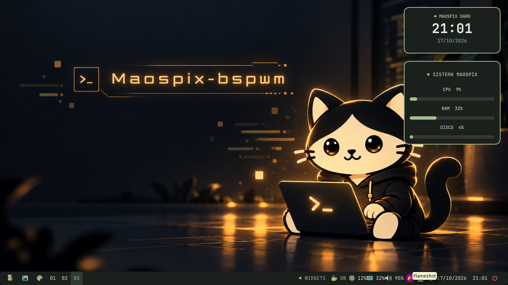
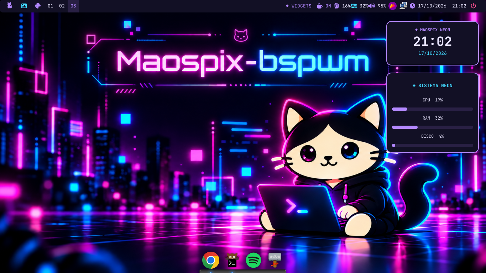
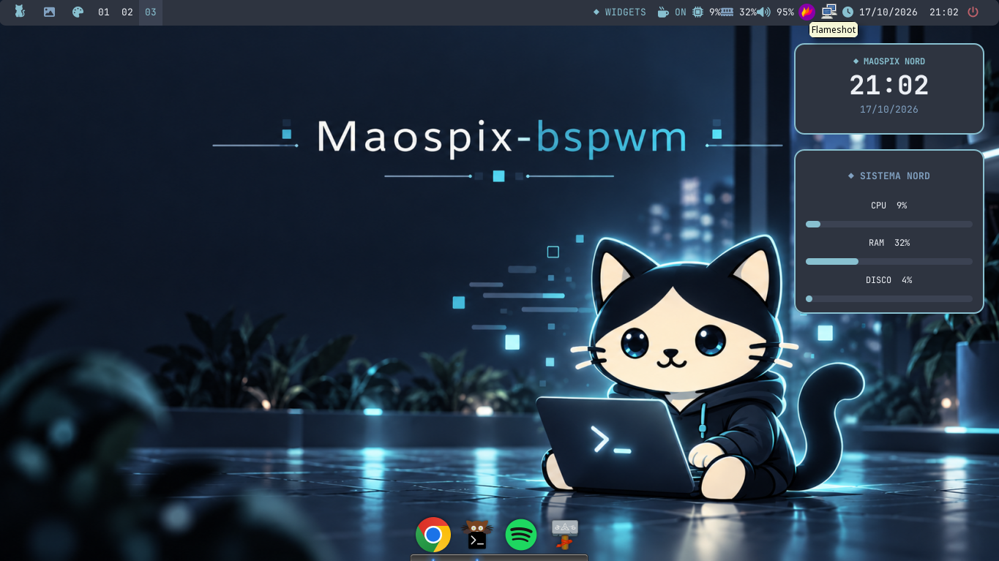
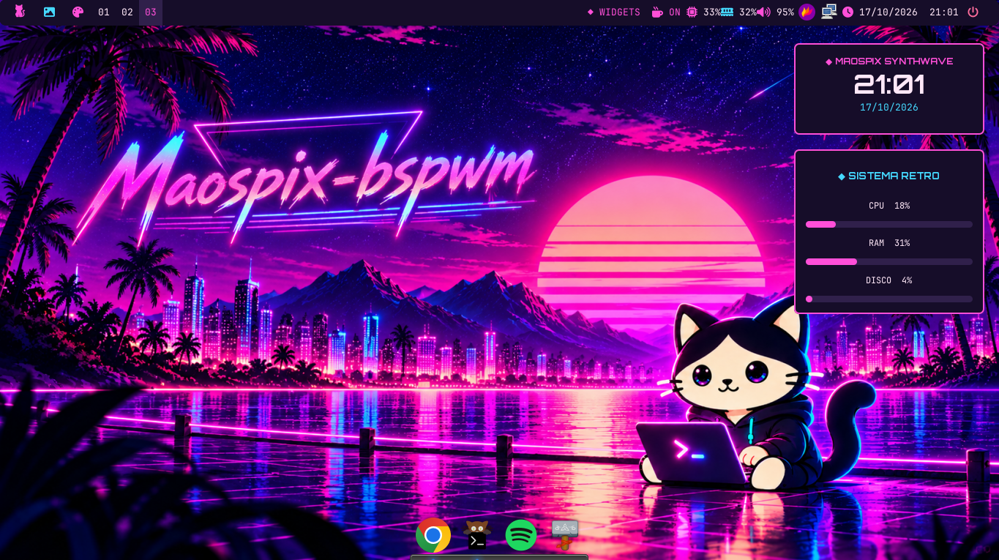

# 🐱 Maospix BSPWM

**Un escritorio moderno, ligero y personalizable basado en Fedora Linux, BSPWM y X11.**

Maospix BSPWM es un proyecto de personalización de escritorio que combina un gestor de ventanas ligero con componentes visuales modernos, temas intercambiables, widgets y herramientas integradas.

Su objetivo es ofrecer una experiencia visual completa mediante un instalador automatizado para Fedora Linux y, posteriormente, una imagen ISO propia.

> **Estado del proyecto:** versión de desarrollo (Alpha).
> El instalador todavía requiere pruebas completas en una instalación limpia de Fedora.

---

## 🎨 Temas disponibles

| Tema | Descripción |
|------|-------------|
| Dark | Oscuro, elegante y minimalista |
| Neon | Estilo futurista con tonos violetas y cian |
| Retro | Inspirado en Synthwave y Retrowave |
| Nord | Tonos azules fríos y estética tecnológica |

Todos los temas incluyen configuraciones personalizadas para Polybar, Rofi y otros componentes del escritorio.

<!-- MAOSPIX-SCREENSHOTS:START -->
## 📸 Capturas reales de Maospix BSPWM

Estas son capturas reales de los cuatro temas actuales de **Maospix BSPWM**.

| Dark | Neon |
|------|------|
|  |  |

| Nord | Retro |
|------|------|
|  |  |
<!-- MAOSPIX-SCREENSHOTS:END -->

---

## 🖥️ Componentes

| Componente | Tecnología |
|------------|------------|
| Sistema base | Fedora Linux |
| Servidor gráfico | Xorg / X11 |
| Gestor de ventanas | BSPWM |
| Atajos de teclado | SXHKD |
| Barra superior | Polybar |
| Terminal principal | Kitty |
| Terminal alternativa | Alacritty |
| Lanzador de aplicaciones | Rofi |
| Información del sistema | Polybar |
| Información del sistema | Fastfetch |
| Compositor | Picom |
| Notificaciones | Dunst |
| Dock | Plank |
| Fondos de pantalla | Feh |
| Pantalla de inicio de sesión | LightDM |
| Bloqueo | Light Locker |

Maospix incluye un Power Menu personalizado, selector de temas y galería visual de wallpapers.

---

## 📋 Requisitos

- Fedora Linux 44 como entorno inicial de desarrollo y pruebas.
- Conexión a Internet.
- Usuario normal con permisos sudo.
- Git para descargar el repositorio.
- Espacio disponible para instalar los paquetes de Maospix.

Se recomienda probar inicialmente en una máquina virtual o instalación limpia.

**No se recomienda ejecutar todavía el instalador sobre un sistema de producción.**

---

## 🚀 Instalación en Fedora

### 1. Preparar Fedora

Actualizar el sistema:

    sudo dnf upgrade --refresh

Instalar Git:

    sudo dnf install git

### 2. Descargar Maospix

Por HTTPS, con acceso autorizado al repositorio:

    git clone https://github.com/maospy/maospix-bspwm.git

Alternativamente, mediante SSH previamente configurado:

    git clone git@github.com:maospy/maospix-bspwm.git

Entrar al proyecto:

    cd maospix-bspwm

### 3. Comprobar los requisitos

    bash maospix.sh --check dark

El instalador mostrará los paquetes presentes y los faltantes.

### 4. Instalar Maospix

    bash maospix.sh --install dark

Para seleccionar otro tema inicial:

    bash maospix.sh --install dark
    bash maospix.sh --install neon
    bash maospix.sh --install retro

El instalador solicitará confirmación antes de proceder.

**Importante:** la instalación completa todavía no está validada en Fedora limpio. Realizarla únicamente en un entorno de pruebas y revisar las modificaciones propuestas.

### 5. Iniciar sesión

Una vez completada satisfactoriamente la instalación, reiniciar cuando corresponda y seleccionar BSPWM desde el gestor de sesiones.

Si el sistema ya utiliza otro gestor de sesiones, el instalador no garantiza sustituirlo automáticamente por LightDM.

---

## 📁 Organización del proyecto

| Directorio o archivo | Función |
|----------------------|---------|
| `maospix.sh` | Instalador descargable |
| `install.sh` | Instalador principal |
| `packages/` | Dependencias Fedora |
| `scripts/` | Instaladores y funciones auxiliares |
| `themes/` | Configuraciones de los cuatro temas |
| `components/` | Componentes visuales |
| `assets/` | Logos y fuentes |
| `config/` | Configuraciones generales |
| `wallpapers/` | Fondos seleccionados |
| `docs/` | Documentación del proyecto |

---

## 🔒 Estado del repositorio

Actualmente, Maospix BSPWM se desarrolla en un repositorio privado de GitHub.

Las descargas requieren acceso autorizado hasta que se decida publicar oficialmente el proyecto.

---

## ⚠️ Advertencias

El instalador puede instalar paquetes y modificar configuraciones del usuario.

Algunos módulos realizan respaldos en `~/Respaldos-Maospix/`, pero todavía no existe una garantía de recuperación integral ni un desinstalador completo.

No utilizar el instalador con `sudo bash`; debe ejecutarse desde una cuenta de usuario normal.

---

## 🛠️ Próximos objetivos

- Validar la instalación completa en Fedora limpio.
- Corregir las dependencias y configuraciones detectadas durante las pruebas.
- Completar la documentación y las capturas de pantalla.
- Publicar una primera versión estable del instalador.
- Crear una ISO Live basada en Fedora con Maospix BSPWM preconfigurado.

---

## 🖼️ Wallpapers y recursos

El repositorio incorpora wallpapers seleccionados para Maospix.

Otros fondos utilizados durante el desarrollo no se incluyen mientras no se verifiquen sus derechos de redistribución.

Consultar `docs/wallpapers-auditoria.md`.

---

## 👨‍💻 Proyecto

**Maospix BSPWM**

Desarrollado y personalizado por maospy.

Repositorio: https://github.com/maospy/maospix-bspwm

**Estado actual: Alpha — en desarrollo.**


---

## Widgets laterales y funcionamiento

Maospix concentra la información esencial del sistema en Polybar. Los widgets de escritorio no forman parte del núcleo y podrán añadirse posteriormente como extras opcionales.


**Comprobación:** `bash install.sh --check-all`; **instalación de prueba:** `bash maospix.sh --install dark`. Reiniciá la sesión gráfica solamente después de comprobar que termina sin errores. El repositorio es público y puede descargarse directamente desde GitHub.

Los fondos de pantalla tienen una auditoría de origen en `docs/wallpapers-auditoria.md`. Los recursos de origen o licencia desconocidos no deben agregarse a GitHub ni incluirse en una ISO pública sin comprobar sus permisos.


### Aplicaciones incluidas (Fedora)

El instalador principal prepara Brave (repositorio RPM oficial) y CLIAMP
(v1.63.1, binario SHA256 verificado con aviso MIT). También instala Fastfetch
desde los repositorios Fedora y lo muestra automáticamente al iniciar Kitty.
Para reintentar las aplicaciones externas sin reinstalar el escritorio:

```bash
bash scripts/maospix-install-apps.sh --install
```

Los cuatro temas Dark, Neon, Retro y Nord funcionan sin depender de un sistema externo de widgets;
el menú de apagado toma la paleta del tema actual al abrirse.


### Inicio predeterminado

El tema oficial por defecto es **Dark**. `bash maospix.sh --install` prepara Dark automáticamente; los otros temas siguen disponibles en Polybar.

## Instalación rápida

Maospix BSPWM puede instalarse directamente desde GitHub en Fedora:

```bash
bash <(curl -fsSL https://raw.githubusercontent.com/maospy/maospix-bspwm/main/maospix.sh) --install dark
```

Para comprobar compatibilidad sin instalar:

```bash
bash <(curl -fsSL https://raw.githubusercontent.com/maospy/maospix-bspwm/main/maospix.sh) --check dark
```

Temas disponibles: `dark`, `neon`, `retro` y `nord`.
